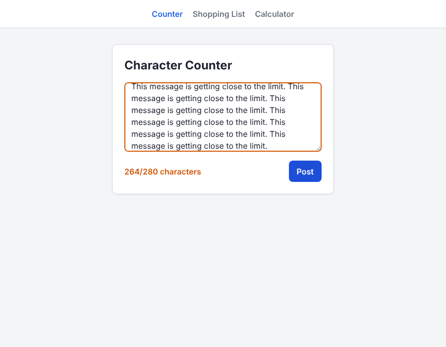
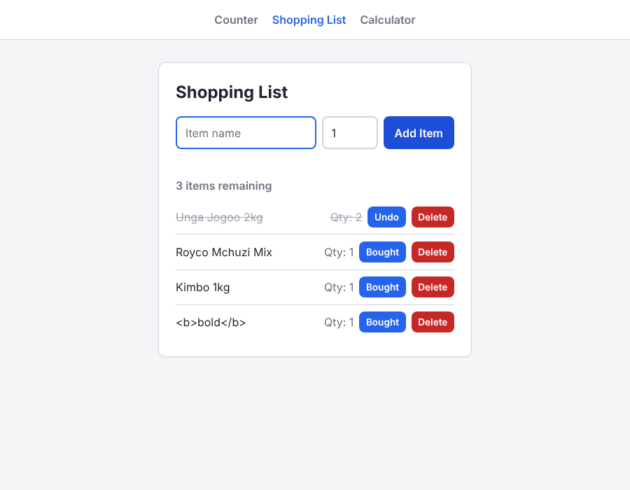
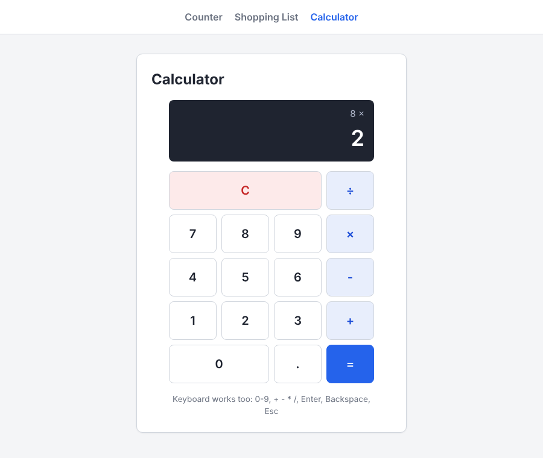

# Week 2 Day 3 Assignment

Three small browser apps built with plain HTML, CSS and JavaScript, focused on the DOM: selecting elements, listening for events and updating the page.

**Live demo:** 

| App | Page | Script |
| --- | ---- | ------ |
| Character Counter | `counter.html` | `counter.js` |
| Shopping List | `shopping-list.html` | `shopping-list.js` |
| Calculator | `calculator.html` | `calculator.js` |

All three share one stylesheet, `styles.css`. There are no dependencies and no build step: open `index.html` in a browser.

---

## Task 1: Character Counter

A textarea with a 280-character limit and a live count underneath.



- Shows `N/280 characters` and updates on every keystroke, using `addEventListener("input", ...)`.
- **Orange** from 261 to 280 characters, **red** above 280. The textarea border changes to match.
- The Post button is disabled when the message is empty or over the limit.

## Task 2: Dynamic Shopping List



- Add an item with a name and a quantity (default 1). Pressing Enter also adds it.
- **Bought** strikes the item through and greys it out (press again to undo). **Delete** removes it.
- A counter shows how many items are left to buy.
- An empty name shows a red error under the inputs. An invalid quantity does too.
- Every item is built with `document.createElement()`, never `innerHTML`.

## Task 3: Calculator



- Buttons for 0-9, `.`, `+`, `-`, `×`, `÷`, `=` and `C`, all generated in JavaScript from one array.
- Operations chain step by step, so `5 + 3 × 2 =` gives `16` (5 + 3 = 8, then 8 × 2).
- One decimal point per number. Division by zero shows `Error`. Floating point noise is rounded away, so `0.1 + 0.2` shows `0.3`.

### Bonus: keyboard support

| Key | Action |
| --- | ------ |
| `0`-`9` | Type a digit |
| `+` `-` `*` `/` | Choose an operator |
| `Enter` or `=` | Evaluate |
| `Escape` or `c` | Clear |
| `.` | Decimal point |
| `Backspace` | Delete the last character |

---


## Project structure

```
.
├── index.html
├── counter.html        counter.js
├── shopping-list.html  shopping-list.js
├── calculator.html     calculator.js
├── styles.css
├── screenshots/
└── README.md
```
